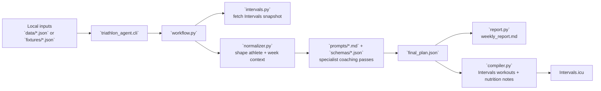
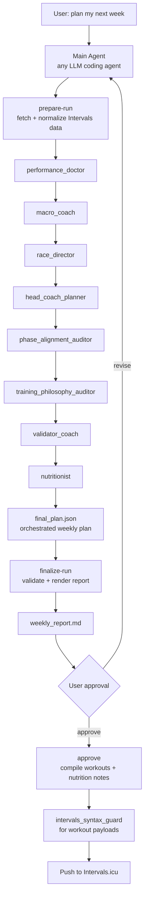

# Triathlon Agent

**Running-only prompts:** `prompts/master_prompt.md` and the specialist prompts now plan road, trail and ultra running, with optional supporting strength and recovery. They do not prescribe cycling or swimming. The Python package, schemas, starter inputs and deterministic `plan-week` stubs still retain legacy multisport support; use the agent-driven `prepare-run` / `finalize-run` workflow for running-only planning. Use a runner-specific local profile rather than copying the triathlon example's hours or constraints unchanged.

Local, on-demand endurance coaching workflow that plans one training week at a time for triathlon, road running and trail / ultra races.

It is agent-agnostic: any LLM coding agent that can run shell commands and read and write files (Claude Code, OpenCode, Codex, Cursor, ...) can act as the orchestrator and run the chain of specialist coaching prompts. The coaching logic lives in plain Markdown prompts and JSON schemas, not in a vendor-specific integration. A standard-library-only Python layer does the deterministic work around it: it fetches your Intervals.icu data, measures load and readiness, audits the plan against the coaching doctrine, and pushes structured workouts back to Intervals.icu only after you approve the week.

## What it does

- **Reads your real training data:** activities, wellness (HRV, resting HR, sleep), sport settings and calendar events from Intervals.icu.
- **Monitors load like a coach:** CTL ramp and TSB, intensity distribution, HRV gate, underload and overreaching, return after a break, and run-specific caps on km, time and descent.
- **Plans around your races:** A/B/C races come from your Intervals calendar and drive the phases, B-race mini-tapers, tapers and post-race transitions.
- **Progresses gradually:** time-in-zone progression ladders, with a budget on how many elements can progress in one week.
- **Keeps zones honest:** it schedules FTP, threshold-pace and LTHR tests itself and proposes guarded sport-setting updates.
- **Audits every plan:** `finalize-run` checks the week against the doctrine and puts a coaching audit at the top of the report.
- **Writes back safely:** nothing is pushed without approval, approval is bound to the exact plan, and workouts you edited in Intervals are left alone.
- **Adjusts mid-week:** re-plan the remaining days after illness, a bad night or travel.

## System Diagram



In practice the code does four things:

- collect athlete inputs plus Intervals history
- normalize that into one planning snapshot
- produce a weekly plan and report through the specialist prompt chain
- compile and push workouts only after explicit approval

## Public Repo Notes

This repository is safe to commit publicly when you keep these local-only files out of git:

- `.env`
- `data/athlete_profile.json`
- `data/weekly_checkin.json`
- `data/race_calendar.json`
- `data/athlete_state.json` (and its `.bak`), the long-term memory the workflow writes
- everything under `runs/`

The committed repo should contain:

- `triathlon_agent/` runtime code
- `prompts/` and `schemas/` planning contracts
- `fixtures/` deterministic mock data
- `tests/` verification
- `data/*.template.json` starter inputs
- docs such as `README.md`, `DESIGN.md`, `AGENT_WORKFLOW.md`, `PLAN_MY_WEEK_SPEC.md`, and the technical slide deck `triathlon-agent-public-deck.html`

The intended production workflow is:

- you say `plan my next week` to your coding agent
- that main agent becomes the orchestrator
- it fetches a fresh Intervals snapshot before any coaching reasoning
- it summarizes last week from Intervals, asks only targeted follow-up questions, and then drafts the week
- it calls the specialist prompt files one by one
- the Python helper layer fetches Intervals data, stores artifacts, validates files, compiles workouts, and pushes only after approval

The Python layer can also run a deterministic stub workflow for tests and fixture-backed dry-runs.

It can run in:

- `mock` mode with fixtures and dry-run write-back
- `live` mode against Intervals.icu using a personal API key

It is intentionally simple:

- pull athlete data
- normalize it
- let the main agent run specialist prompts in order
- generate a weekly report
- require approval before write-back
- compile approved workouts into Intervals.icu workout syntax or structured calendar events
- compile separate nutrition note events for meaningful days
- push workouts only after approval

## Folder structure

- `prompts/` agent prompts and master prompt for the main agent
- `schemas/` JSON contracts for agent outputs and the final plan
- `data/` editable templates for athlete profile, weekly check-in, and optional race-calendar supplements; your filled-in `.json` files stay local
- `fixtures/` mock Intervals data and example local inputs
- `triathlon_agent/` helper code for preparation, validation, compilation, adapters, and deterministic stub mode. Key modules:
  - `intervals.py`: Intervals.icu API adapter (live) and fixture adapter (mock)
  - `normalizer.py`: builds the planning snapshot
  - `training_load.py`, `progression.py`, `threshold_testing.py`: deterministic coaching signals
  - `plan_audit.py`, `coaching_limits.py`: the doctrine audit and its shared thresholds
  - `athlete_state.py`, `memory.py`, `checkin.py`: long-term memory and check-ins
  - `compiler.py`, `report.py`: Intervals workout syntax and the weekly report
  - `agents/`: deterministic stubs of the specialist agents, used by `plan-week` and the tests
- `tests/` automated workflow tests
- `runs/` local run artifacts generated by the CLI

## Requirements

- Python 3.11+
- no third-party Python dependencies required

## Configuration

1. Copy `.env.example` to `.env` if you want live Intervals access.
2. Create local input files from the templates:

```bash
cp data/athlete_profile.template.json data/athlete_profile.json
cp data/weekly_checkin.template.json data/weekly_checkin.json
cp data/race_calendar.template.json data/race_calendar.json  # optional
```

3. Fill in your local `data/*.json` files. They are intentionally gitignored.
4. For deterministic dry-runs, you can skip local data entirely and use `fixtures/*.json`.

`data/athlete_state.json` needs no template: the workflow creates it (at the latest when you approve your first week) and it keeps the block counter, weekly actuals, race results, injury log, open decisions and threshold-test history. Every write keeps the previous version as `athlete_state.json.bak`. Set `TRIATHLON_AGENT_STATE_DIR` to store it elsewhere.

Relevant environment variables:

- `TRIATHLON_AGENT_MODE=mock|live`
- `INTERVALS_API_KEY=...`
- `INTERVALS_ATHLETE_ID=0`
- `TRIATHLON_AGENT_RUNS_DIR=runs`
- `TRIATHLON_AGENT_STATE_DIR=data` (optional, where `athlete_state.json` lives)

## Commands

| Command | What it does |
| --- | --- |
| `prepare-run` | Fetch and normalize Intervals data into a new run folder; stops before drafting |
| `record-checkin <run> <answers.json>` | Merge the post-fetch check-in answers and re-normalize the snapshot |
| `finalize-run <run>` | Validate the agent outputs, run the coaching audit and render `weekly_report.md` |
| `approve <run>` | Record approval, compile workouts and nutrition notes, and push them (`--dry-run` to preview) |
| `adjust-week <run> --from YYYY-MM-DD` | Re-plan the remaining days of an approved week in a new linked run |
| `plan-week` | Run the whole chain with the deterministic stub agents (tests and dry-runs) |

All commands run as `python3 -m triathlon_agent.cli <command> ...`; most take `--mode mock|live`.

## Weekly check-in fields

The template `data/weekly_checkin.template.json` is valid JSON. Copy it to `data/weekly_checkin.json` and replace values with your own. The examples below are illustrative, not defaults or a suggested training week. Use `null` for unknown or unanswered fields; use `[]` or `{}` when you know there are no items. Do not copy example symptoms, decisions or dates as if they were your own.

| Key | What to enter | Example JSON value |
| --- | --- | --- |
| `planning_date` | Date the plan is prepared for, in YYYY-MM-DD format. | `"2026-03-08"` |
| `last_week_summary` | How last week's training went. | `"Ran four times; Sunday's long run felt comfortable."` |
| `missed_sessions` | Sessions missed or cut short. | `["Thursday intervals"]` |
| `missed_session_reasons` | Map each missed session to its reason. | `{"Thursday intervals": "Worked late"}` |
| `unexpected_fatigue` | Unusual tiredness and possible context, or `null` if unknown. | `"Tired after two nights of poor sleep"` |
| `open_water_mode` | Legacy swimming setting; leave `false` for running-only use. | `false` |
| `time_constraints` | Schedule restrictions in plain language. | `["Wednesday: at most 45 minutes"]` |
| `travel_this_week` | Whether you are travelling this week. | `true` |
| `current_motivation` | Motivation from 1 to 10. | `8` |
| `subjective_readiness` | How ready you feel to train, from 1 to 10. | `6` |
| `pain_or_niggles` | Describe location, symptoms and when they occur. | `"Left calf feels tight after running"` |
| `pain_scores` | Pain from 0 to 10 for each affected body part. | `{"left calf": 2}` |
| `illness_symptoms` | Symptoms, including location and timing; use `[]` if none. | `["Sore throat since Monday"]` |
| `red_flags` | Concerning symptoms; use `[]` if none. | `["Dizziness during a run"]` |
| `sleep_quality` | Sleep quality from 1 (very poor) to 5 (great). | `3` |
| `work_stress` | Work/life stress from 1 (calm) to 10 (overwhelming). | `7` |
| `athlete_notes` | Other context or preferences for this week. | `"Sunday is best for my long run"` |
| `upcoming_events` | Events or constraints in the next 2–4 weeks. Races and priorities still come from Intervals. | `["Work trip next Thursday"]` |
| `race_debrief` | After a race, describe pacing, fuelling and how you feel now; otherwise use `null`. | `"10k: started too fast; legs recovered after two days"` |
| `available_hours_override_min` | This week's available training time in minutes; it binds. | `300` |
| `available_hours_hard_cap_min` | Hard weekly training-time cap in minutes; it binds. | `330` |
| `double_session_capacity_by_day` | Days when two sessions are or are not feasible. | `{"Tuesday": true, "Wednesday": false}` |
| `time_caps_by_day` | Hard daily time caps in minutes. | `{"Wednesday": 45}` |
| `decision_answers` | Answer an open decision using its question or ID. | `{"Enter the Leuven 10k?": "yes"}` |
| `bike_test_protocol` | Legacy bike setting; leave `null` for running-only use. For cycling, supported values include `"coggan_20"` and `"friel_30"`. | `null` |

Chest pain, palpitations, disproportionate breathlessness, dizziness or fever warrant stopping training and medical assessment. Record symptoms honestly; an empty or unknown answer is not evidence that you are healthy.

Answer the post-fetch check-in with `record-checkin` (see below); its answers are merged into the run and the snapshot is re-normalized before planning.

## Races come from your Intervals calendar

Races, priorities (A/B/C) and dates come only from Intervals.icu RACE events. The optional local race calendar can only add notes to a race that is already on the Intervals calendar; it never adds a race or changes its date, name or priority. Entries it cannot match are listed in `race_calendar_warnings`. `data/athlete_state.json` keeps history only, never the priority race.

Wellness baselines for HRV, resting HR, and sleep are derived from Intervals.icu wellness history whenever enough data exists. Manual baseline fields in `data/athlete_profile.json` are optional fallback overrides only.

The permanent athlete profile now separates:

- `hard_constraints`
- `soft_preferences`
- `phase_preferences`
- `decision_policy`

### `data/athlete_profile.json` fields

The template is valid JSON, so explanations live here rather than as comments inside the file. Replace example values with your own; fields for sports you do not train can be left out or left blank.

- `name`, `age`, `sex`: basic athlete context. `sex` is context for coaching, not a training prescription.
- `training_age_years`: years of consistent structured training, not age in years.
- `primary_sport_background`: sport you have the most experience in.
- `current_level`: your current ability or experience in your own words.
- `target_race_distance`: the distance/event type you are preparing for; race dates and priorities belong in the Intervals.icu calendar.
- `primary_performance_goal`, `secondary_goal`: the main outcome you want and another useful supporting goal. These are background guidance, not a replacement for calendar races.
- `typical_training_hours_per_week`: usual weekly training availability; this is a reference, not a cap for a particular week.
- `preferred_long_ride_day`, `preferred_long_run_day`: preferred days for long bike/run sessions, if those sports apply.
- `non_negotiable_days_off`: weekdays that must stay free of training.
- `strength_days`: preferred days for strength training.
- `injury_history`: past or recurring injuries and relevant triggers; include current issues in the weekly check-in too.
- `known_constraints`: other scheduling, access, equipment, or life constraints, in plain language.
- `hard_constraints.always`: requirements that apply every week. `hard_constraints.when_open_water_mode_false`: requirements that apply only when the weekly check-in says open-water mode is false (primarily for swim/pool-season planning).
- `soft_preferences.weekday_rhythm`, `soft_preferences.weekend_structure`: preferred patterns the planner can move if training needs or hard constraints require it.
- `phase_preferences.early_phase_bias`: priorities you prefer early in a training cycle, where appropriate.
- `decision_policy.sequencing_priority`: what should take precedence when fitting sessions together (example: physiological sequencing).
- `decision_policy.routine_override_rule`: when the plan may depart from your usual routine and how that change should be handled.
- `typical_sleep_hours`: usual sleep duration in hours.
- `hrv_baseline`, `resting_hr_baseline`: optional manual fallback values; normally derived from Intervals.icu wellness history when enough data is available. Use `null` if unknown.
- `threshold_testing.bike_protocol`, `threshold_testing.bike_protocol_alternative`, `threshold_testing.run_protocol`: preferred test protocols for setting bike/run training thresholds. Omit sports you do not train; use supported protocol names from the threshold-testing guidance.
- `coaching_tone_preference`: how you want coaching feedback phrased (for example, direct, encouraging, or detailed).

The coaching philosophy is explicitly organized around:

- `Joe Friel` for periodization and race-phase structure
- `Jack Daniels` for run taxonomy
- `Andrew Coggan` for bike taxonomy
- `prompts/training_intensity_doctrine.md` for intensity and progression:
  - pyramidal distribution by default
  - quality-session count from the readiness allowance and HRV gate
  - underload detection
  - time-in-zone progression ladders, including VO2max / I work and ultra-trail uphill threshold

There is no session library: the head coach designs every session. Deterministic support lives in:

- `triathlon_agent/training_load.py`, which feeds `normalized_snapshot.training_load`:
  - CTL ramp and TSB (thresholds scale with CTL)
  - 28-day three-zone distribution (power zones for rides when available)
  - quality frequency
  - HRV gate (`stale` when HRV is more than 2 days old)
  - eFTP trend
  - underload markers, with a physiological veto (`explained_physiological`)
  - `return_from_break`: a 50 → 60 → 75 → 90% re-entry ramp after 7+ days off
  - run-specific ACWR and `week_caps` for run km, minutes, descent and the long run
  - `daily_signals`: a 1–3 day resting-HR / HRV early warning
  - `overreaching` (functional vs non-functional) and `efficiency_trend`
- `normalized_snapshot.activity_note_flags`: pain, illness and red-flag words from activity descriptions and comments (EN + NL)
- `triathlon_agent/progression.py`, which feeds `normalized_snapshot.progression`: the last completed dose per ladder family and the next rung.
- `triathlon_agent/plan_audit.py`, run by `finalize-run`: a deterministic check of `final_plan.json` against the doctrine. It writes `coaching_audit` into the final plan and a `## Coaching Audit` section at the top of the report. It warns but never blocks approval. It flags:
  - under-dosed green weeks
  - underload not addressed
  - quality above the allowance
  - missing `progression` objects
  - no rung progression on the last completed dose
  - quality on consecutive days
  - almost-all-easy weeks, and weeks above the 30% intensity ceiling
  - a missing scheduled threshold test
  - quality inside a recovery week
  - running above `run_load.week_caps` (run km / minutes ~+10%, descent ~+15%), long runs above the cap, and weeks that ignore `return_from_break`
  - more than two progressing elements, or more than one run-impact element (the progression budget)
  - heavy leg strength before a key session, and hard work across the week boundary
  - quality within 72 h before a B-race, hard work after a race, and over-deep tapers
  - running or descending with a reported pain score of 3/10 or more

All thresholds live in `triathlon_agent/coaching_limits.py`, shared by the audit, the validator and the stub head coach.

## Threshold testing

The agent schedules threshold tests itself so FTP, threshold pace, and LTHR stay correct (`prompts/threshold_testing_doctrine.md`, `triathlon_agent/threshold_testing.py`):

- a recovery week ends with a test (Friel "rest & test") only when a discipline relevant to the A-race is due: a trail block tests the run, and the bike only when the FTP is stale or overdue and bike targets are prescribed; no tests in a return-from-break week
- when the set FTP is more than 10% above a confident eFTP, the interim update is proposed with `apply: true` (still pushed only after you approve the week); when eFTP is more than 5% above the set FTP, targets are scaled up
- at least 42 days between tests of the same discipline (28 with an early trigger such as FTP vs eFTP drift above 5%); 84+ days is overdue
- no tests within 21 days of an A-race or 7 days of a B-race, with red readiness, shortly after illness, or (run) with a reported niggle
- a recent flat road race of 10k or longer counts as the run test
- bike protocol: `coggan_20` (20' x 0.95) by default, `friel_30` (30' TT, final-20' HR = LTHR) as option B; run protocol: Friel 30' TT
- set the default in `athlete_profile.json` under `threshold_testing.bike_protocol`, or override one week with `"bike_test_protocol": "friel_30"` in the weekly check-in
- after a test, `prepare-run` reads its laps from Intervals and proposes new values in the report; `approve` pushes the confident ones to Intervals sport settings and records the test in `data/athlete_state.json`

## Agent-driven workflow

This is the intended production flow.

The exact `plan my week` behavior contract is documented in `PLAN_MY_WEEK_SPEC.md`.

1. In your coding agent (see `AGENT_WORKFLOW.md`; the agent follows `prompts/master_prompt.md`), say something like:

```text
plan my next week
```

2. The main agent should internally run:

```bash
python3 -m triathlon_agent.cli prepare-run \
  --mode live \
  --athlete-profile data/athlete_profile.json \
  --weekly-checkin data/weekly_checkin.json
```

The freeform phrase `plan my week` should prepare the run and stop before drafting. The required post-fetch check-in questions are written into `runs/<run_id>/run_context.json`, and the week must not be drafted until those questions have been asked and answered.

3. The main agent reads:

- `runs/<run_id>/normalized_snapshot.json`
- `runs/<run_id>/run_context.json`
- `prompts/*.md`
- `schemas/*.json`

4. Before drafting, the main agent must:

- verify the fetched Intervals snapshot is fresh enough for planning
- summarize the prior week from the fetched activities and wellness
- ask only for subjective feedback and coming-week constraints that Intervals cannot know
- write the answers to a JSON file and record them, which re-normalizes the snapshot without a new fetch:

```bash
python3 -m triathlon_agent.cli record-checkin runs/<run_id> answers.json
```

In live mode `finalize-run` refuses to run before the check-in is recorded (override with `--allow-missing-checkin`).

5. The main agent calls each specialist and writes:

- `runs/<run_id>/agent_outputs/performance_doctor.json`
- `runs/<run_id>/agent_outputs/macro_coach.json`
- `runs/<run_id>/agent_outputs/race_director.json`
- `runs/<run_id>/agent_outputs/phase_alignment_auditor.json`
- `runs/<run_id>/agent_outputs/training_philosophy_auditor.json`
- `runs/<run_id>/agent_outputs/head_coach_planner.json`
- `runs/<run_id>/agent_outputs/validator_coach.json`
- `runs/<run_id>/agent_outputs/nutritionist.json`
- `runs/<run_id>/final_plan.json`

### Agent Flow



6. The main agent validates and renders the report with:

```bash
python3 -m triathlon_agent.cli finalize-run runs/<run_id>
```

7. You review `runs/<run_id>/weekly_report.md` and approve or request changes.

8. After approval, the main agent pushes workouts with:

```bash
python3 -m triathlon_agent.cli approve runs/<run_id> --mode live
```

Approval is bound to the exact `final_plan.json` (sha256): if the plan changes after approval, `approve` refuses to push and re-finalizing resets the approval to pending. Before pushing, `approve` compares the live calendar with what it pushed last time; events you edited or moved in Intervals are skipped and listed in `edited_events.json` (force with `--overwrite-edited`). Nothing is ever deleted.

When the week goes off the rails mid-week (illness, a bad night, travel), re-plan only the remaining days in a new linked run:

```bash
python3 -m triathlon_agent.cli adjust-week runs/<run_id> --from YYYY-MM-DD --reason "sick since Tuesday" --mode live
```

It fetches fresh data, writes `adjustment_context.json` (done so far vs planned), seeds the remaining days as the draft, and needs its own `finalize-run` and approval. `approve` then pushes only the days from `--from` on.

If you want to inspect the exact helper flow, see `prompts/master_prompt.md` and `runs/<run_id>/run_context.json`.

After approval the system can push:

- structured workouts
- swim placeholders where appropriate
- separate `Nutrition Targets` note events only on days with meaningful guidance

## Deterministic stub workflow

Mock draft plan using the built-in deterministic stub agents:

```bash
python3 -m triathlon_agent.cli plan-week \
  --mode mock \
  --athlete-profile fixtures/athlete_profile.json \
  --weekly-checkin fixtures/weekly_checkin.json
```

Freeform trigger style:

```bash
python3 -m triathlon_agent.cli "plan my week" \
  --mode mock \
  --athlete-profile fixtures/athlete_profile.json \
  --weekly-checkin fixtures/weekly_checkin.json
```

This freeform trigger resolves to `prepare-run`, not `plan-week`, so the main agent can review the snapshot and ask the required weekly check-in questions before drafting.

Approve an existing draft and run compile + push in mock mode:

```bash
python3 -m triathlon_agent.cli approve runs/<run_id> --mode mock
```

End-to-end dry-run in one shot:

```bash
python3 -m triathlon_agent.cli plan-week \
  --mode mock \
  --athlete-profile fixtures/athlete_profile.json \
  --weekly-checkin fixtures/weekly_checkin.json \
  --auto-approve \
  --dry-run
```

Live mode against Intervals.icu using the deterministic stub workflow:

```bash
python3 -m triathlon_agent.cli plan-week \
  --mode live \
  --athlete-profile data/athlete_profile.json \
  --weekly-checkin data/weekly_checkin.json
```

Optional supplemental local race data if you want to enrich Intervals events with extra notes:

```bash
python3 -m triathlon_agent.cli plan-week \
  --mode live \
  --athlete-profile data/athlete_profile.json \
  --weekly-checkin data/weekly_checkin.json \
  --race-calendar data/race_calendar.json
```

Then approve the run:

```bash
python3 -m triathlon_agent.cli approve runs/<run_id> --mode live
```

## Run tests

```bash
python3 -m compileall triathlon_agent tests
python3 -m unittest discover -s tests -v
```

The suite is fixture-driven and needs no Intervals.icu access. A test that reads a local `data/athlete_profile.json` is skipped when that file is absent.

## Approval gate

- `plan-week` always creates `approval.json` with `pending` status unless `--auto-approve` is used.
- `prepare-run` always creates `approval.json` with `pending` status.
- compile and push never happen until the run is approved.
- even in `--auto-approve` mode, the system records the approval event before compilation.

## Notes

- Bike workouts are compiled with `%FTP` targets.
- Easy and aerobic-only runs are compiled with `HR` targets.
- Quality runs are compiled with `Pace` targets based on Intervals threshold pace.
- Strength sessions are pushed as `WeightTraining` workouts with structured notes.
- Swims can be pushed as simple `Swim` calendar events with minimal or empty workout text.
- Nutrition guidance can be pushed as separate daily `NOTE` events titled `Nutrition Targets`.
- Race events are pulled from Intervals calendar data when they are marked as `RACE_A`, `RACE_B`, `RACE_C`, or `TARGET`.
- In production, coaching reasoning is expected to come from the main agent plus prompt files, not from the deterministic Python stubs.
- In production, `plan my week` should not ask you to manually recount completed sessions if live Intervals data has already been fetched.
- Run sessions should declare a Daniels type.
- Bike sessions should declare a Coggan level plus expected IF and estimated TSS.
- The weekly report includes a phase-alignment check and a training-philosophy check.
- The weekly report includes nutrition note previews and the write-back preview includes note counts.

## Assumptions

- Swim sessions are supported as planned calendar events, but the system still treats swim structure more lightly than bike or run structure.
- The source of truth for run pace targets is Intervals run sport settings.
- The source of truth for bike intensity targets is Intervals bike FTP.
- The source of truth for races, dates and priorities is the Intervals calendar; an optional local race calendar can only add notes to races already on it.
- Weekday preferences are soft unless they are real access constraints such as club swims or pool hours.
- The compiler uses conservative, documented Intervals workout syntax.
